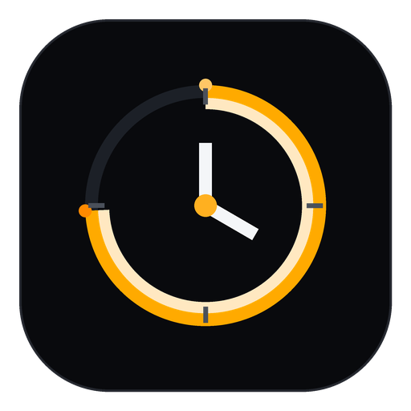

<div align="center">



# CHRONO STUDY

**Plan • Focus • Achieve**

A premium native Android digital clock, study screensaver, Pomodoro / custom focus timer
and diploma study companion — built around one promise: **every focus session produces an
accurate, persistent study record tied to the right subject and chapter.**

<br />

[](https://github.com/Tauseef666-ctrl/Chrono-study/actions/workflows/android-ci.yml)
[](https://github.com/Tauseef666-ctrl/Chrono-study/actions/workflows/release.yml)
[](https://github.com/Tauseef666-ctrl/Chrono-study/releases)
[](LICENSE)


</div>

---

## Overview

**Chrono Study** turns an Android phone into a distraction-free study instrument. Placed
horizontally on a desk, it becomes a beautiful landscape digital clock and screensaver. Picked
up, it becomes a complete study-management system: subjects and chapters, focus and break
timers, a daily planner, analytics and exam preparation.

It is a **native** application — Kotlin, Jetpack Compose and Material 3 — that works fully
**offline**, keeps study history in a local Room database and derives every statistic from real
persisted records. No mock numbers, no fake timers, no WebView.

> **Project status:** active development. Core foundation (design system, data layer, timer
> engine, CI/CD) is in place; feature screens are being delivered incrementally. See the
> [changelog](CHANGELOG.md) and [releases](https://github.com/Tauseef666-ctrl/Chrono-study/releases).

## Table of contents

- [Key features](#key-features)
- [Tech stack](#tech-stack)
- [Architecture](#architecture)
- [Getting started](#getting-started)
- [Testing](#testing)
- [CI/CD & releases](#cicd--releases)
- [Release signing](#release-signing)
- [How study time is calculated](#how-study-time-is-calculated)
- [Data model](#data-model)
- [Privacy](#privacy)
- [Roadmap](#roadmap)
- [Contributing](#contributing)
- [License](#license)

## Key features

### 🕒 Landscape clock & screensaver
A large, cinematic digital clock for landscape use: 12/24-hour format, optional seconds, date,
battery and charging state, selected subject and chapter, a live focus countdown with a circular
progress ring, today's focused time and goal progress. Optional immersive screensaver mode with
a low-brightness preference and an inactivity dim interval. Every element is configurable with a
live preview.

### ⏱️ Reliable focus timer
An explicit, testable state machine — **Idle → Running → Paused → Completed / Cancelled** — with
pause, resume, finish-early and cancel. The countdown is derived from persisted monotonic
timestamps, so it stays correct across rotation, backgrounding, process death and device
restarts. Completion is recorded **exactly once** (idempotent handlers).

### 📚 Subjects, chapters & progress
Data-driven subjects and chapters (never hard-coded): add, rename, reorder, archive and restore;
set colours, icons, targets and chapter status (not started → in progress → studied → revision
needed → completed). Search, filter and select a subject/chapter before a session.

### 📈 Accurate subject-wise study hours
Only eligible active focus time is counted. Pauses and breaks are excluded. Planned duration is
never used as actual duration. Each interval belongs to exactly one subject/chapter, and
historical attribution survives renames, archives and corrections.

### 📝 Planner, dashboard & analytics
Daily and weekly planner tasks with planned-vs-actual duration, a clean dashboard with streaks
and goal progress, and an analytics screen with daily/weekly/monthly/all-time filters and
accessible charts.

### 🔔 Completion alerts
Sound + vibration, sound only, vibration only or silent — with several bundled tones, preview,
test, configurable vibration patterns and separate focus/break preferences. Notification
permission is requested with a clear explanation and handled gracefully when denied.

### 🎨 Design system
Seven theme presets — **OLED Black, Charcoal, Pure White, Ocean, Amber Focus, Forest, Violet** —
plus accent colours, dark/light support, accessible contrast, system font scaling and
reduced-motion support.

### 💾 Local-first & private
Room + DataStore source of truth, validated JSON backup/restore, CSV export via the system
document picker, and **no** telemetry or accounts.

## Tech stack

| Layer | Technology |
| --- | --- |
| Language | Kotlin 2.0 |
| UI | Jetpack Compose, Material 3, Navigation Compose |
| State | ViewModel, Coroutines, Flow |
| Storage | Room, DataStore (Preferences) |
| Background | AlarmManager, WorkManager, foreground service (user-initiated sessions) |
| Serialization | kotlinx.serialization (backup/restore, export) |
| Build | Gradle (Kotlin DSL), version catalog, Gradle Wrapper |
| CI/CD | GitHub Actions |

## Architecture

Chrono Study follows a layered, unidirectional architecture:

```
Presentation (Compose)  →  ViewModel  →  Domain (timer, stats)  →  Data (Room, DataStore)
                                                              ↘  Android integration (notifications, alarms, vibration)
```

- **Presentation** — Compose screens and reusable components; no business logic.
- **Domain** — timer state machine, elapsed-time maths, statistics, validation (pure & testable).
- **Data** — Room entities/DAOs, repositories and settings storage.
- **Integration** — notifications, vibration, exact alarms, display behaviour, lifecycle.

See [`docs/ARCHITECTURE.md`](docs/ARCHITECTURE.md) for details.

## Getting started

### Prerequisites
- Android Studio (Ladybug or newer) **or** the Android SDK command-line tools
- JDK 17
- Android SDK Platform 35 and Build-Tools 35.0.0

### Build & run

```bash
git clone https://github.com/Tauseef666-ctrl/Chrono-study.git
cd Chrono-study
./gradlew assembleDebug          # build the debug APK
./gradlew installDebug           # install on a connected device/emulator
```

The APK is written to `app/build/outputs/apk/debug/`.

### Useful tasks

| Command | Purpose |
| --- | --- |
| `./gradlew assembleDebug` | Build debug APK |
| `./gradlew assembleRelease` | Build release APK |
| `./gradlew testDebugUnitTest` | Run unit tests |
| `./gradlew lintDebug` | Run Android Lint |

## Testing

Tests are deterministic — timing logic uses an injectable time provider, so no test ever waits
25 minutes. Coverage focuses on the timer state machine, study-time aggregation, edge cases
(midnight, time-zone and clock changes, interruption/reboot recovery), alerts and UI flows.

```bash
./gradlew testDebugUnitTest
```

## CI/CD & releases

| Workflow | Trigger | Output |
| --- | --- | --- |
| [`android-ci.yml`](.github/workflows/android-ci.yml) | push / PR to `main`, manual | unit tests, lint, debug APK artifact + reports |
| [`release.yml`](.github/workflows/release.yml) | `v*` tag, manual | release APK attached to a GitHub Release |

**Cut a release** by pushing a version tag:

```bash
git tag v1.0.0
git push origin v1.0.0
```

The workflow builds the release APK and attaches it to the GitHub Release, along with
auto-generated release notes.

## Release signing

The release build always produces an **installable** APK. Without signing configuration it
falls back to the debug key so CI can publish an artifact. For a properly signed release, create
a `keystore.properties` file in the project root (never committed):

```properties
storeFile=/absolute/path/to/release.keystore
storePassword=********
keyAlias=chrono
keyPassword=********
```

For GitHub Actions, add these repository secrets and `release.yml` signs automatically:

| Secret | Purpose |
| --- | --- |
| `KEYSTORE_BASE64` | Base64 of the keystore (`base64 -w0 release.keystore`) |
| `KEYSTORE_PASSWORD` | Keystore password |
| `KEY_ALIAS` | Key alias |
| `KEY_PASSWORD` | Key password |

Without the secrets the release workflow still publishes an APK — signed with the debug key.

## How study time is calculated

1. A session records **planned** duration, **actual eligible focus** duration, wall-clock
   start/end timestamps and accumulated paused time.
2. Elapsed intervals are measured with a **monotonic clock** during a boot session; enough state
   is persisted to reconstruct the session after process death or reboot.
3. Only eligible active focus time is aggregated. Pauses, breaks and setup time are excluded.
4. Changing the device clock cannot make the countdown jump backwards or count an interval twice;
   wall-clock time is used only for calendar grouping.
5. Totals are recomputed from saved records; deleting or correcting a session recomputes the
   affected statistics.
6. The completion handler is **idempotent** — duplicate callbacks cannot create duplicate
   records or alerts.

## Data model

Core Room entities:

| Entity | Purpose |
| --- | --- |
| `Subject` | name, description, colour/icon, target duration, sort order, archive state |
| `Chapter` | subject reference, name, unit label, progress status, notes, sort order, archive state |
| `StudySession` | subject/chapter, planned & actual duration, start/end, paused time, state, note |
| `PlannerTask` | subject/chapter, planned dates/times & duration, status, notes |
| `DailyGoal` | date key and target duration |

Derived values (totals, streaks, charts) are calculated from saved sessions rather than stored
as fragile caches.

## Privacy

- No accounts, no analytics, no tracking, no network access required for any core feature.
- Study data never leaves the device unless **you** explicitly export or back it up.
- Backup/export uses the system document picker and a validated, versioned JSON format.

## Roadmap

- [x] Project foundation, design system, CI/CD
- [ ] Data layer (Room + DataStore) and repositories
- [ ] Timer state machine and study-time engine
- [ ] Landscape clock and screensaver mode
- [ ] Focus/break timers and completion alerts
- [ ] Dashboard, planner, history, analytics, chapter progress
- [ ] Backup/restore, widgets, accessibility pass

## Contributing

Contributions are welcome. Please read [`CONTRIBUTING.md`](CONTRIBUTING.md) and the
[`CODE_OF_CONDUCT.md`](CODE_OF_CONDUCT.md) first. Use the issue and pull-request templates so
changes are easy to review.

## License

Released under the [MIT License](LICENSE) © Tauseef.

---

<div align="center">

**Syllabus note** — Chrono Study can import official **BTEUP** subject and unit names when they
can be verified for the correct branch, semester and scheme. Unverified chapter lists are
labelled **user-editable / unverified** and are never presented as official.

<br />

Made with ☕ and focus.

</div>
